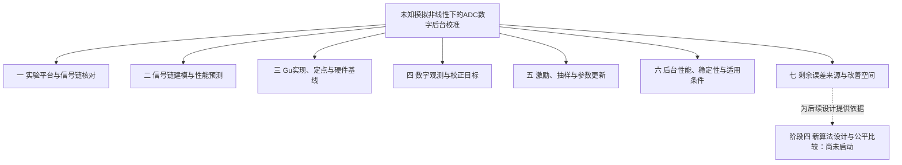

# 项目目录与研究分类

> 整理日期：2026-10-16。研究进度依据截至2026-10-15的原始文档。
> 用户于2026-10-16确认本稿；七篇研究汇报见[第6节](#6-七个模块的研究汇报)。用户随后要求按计划清理目录，执行结果已整合到第4节。
> 本文负责已确认分类、目录处理及模块汇报入口。现行研究安排仍以[主线计划](../RESEARCH_PLAN_STATIC_FIXED_POINT_DIAGNOSTICS_2026-10-10.md)和[STATUS](../STATUS.md)为准。

项目已经建立了实验平台、条件理论和Gu算法的软件／硬件候选，并对一批有限场景形成了剩余误差的解释。当前工作主要处于阶段二、三。**一般未知输入下的完整理论、能够公平胜过Gu的新算法，以及芯片层面的适用性仍未完成。**

目前最需要改善的是研究成果的组织和讲述。建议保留原始实验、推导和运行路径，先按七个研究问题组织人类读者的汇报。每个模块讲清楚一件事，再链接支持它的实验。

## 1. 项目到底在回答什么

流水线ADC把尚未量化的残余电压放大后送往后级。如果放大倍数随电压改变，最终数字码就可能失真。本项目研究：**在运行中的数字算法不知道模拟放大器真实曲线时，能用哪些内部数字信号校正这种误差，效果又受到什么限制。**

Gu基线用分段线性函数校正数字码，并利用已知微小扰动与输出之间的统计关系调整系数。这个扰动称为dither。分段线性描述的是数字校正函数，不规定模拟放大器必须是分段直线。

研究需要连起四个问题：

1. **信息够不够？** 内部数字观测能否区分需要不同校正的情况。
2. **校正结构够不够？** 即使知道合适系数，现有数字函数能消除多少误差。
3. **学习过程能否得到好系数？** 是否存在偏移、持续变化、启动缓慢或输入变化后恢复困难。
4. **最终收益是否值得？** 输出误差、频谱和实现成本是否同时满足要求。

模拟真值、理想输入和离线最优参照可以用于研究者评分，不能成为原在线算法的输入。后面各模块都沿用这一边界。

## 2. 之前的工作大致经历了什么

下表是研究逻辑的概括，不表示每一时期只研究一件事，也不把旧实验名称中的“阶段”当成现行阶段划分。

| 研究过程 | 主要做了什么 | 对当前工作的意义 |
|---|---|---|
| 建立可检查的平台 | 核对逐级判决、残余电压、数字重构、非理想开关及指标计算；接入自适应校准 | 有了可以保存中间信号、重复比较的实验基础 |
| 建立条件性性能预测 | 在给定模拟传输和动态假设下，计算码转换边界、静态误差及频谱；随后研究不确定范围的传播 | 可以检验“这些假设会产生什么结果”，但不能据此宣布真实未知传输已经求解 |
| 重新审查未知增益与信息边界 | 区分模拟传输、数字校正和离线理想参照；用平滑曲线、独立主辅路径及反例检查早期解释 | 研究从已知模型的逆校正，转向算法实际可见信息能支持什么 |
| 分析Gu的学习过程 | 研究门控选样、dither统计、更新时序、定点量化、相关量为零的位置及参数变化 | 发现“学习统计趋于零”“系数暂时变化小”和“输出误差小”需要分别判断 |
| 评价持续后台运行 | 加入百万量级学习、同输入持续运行、主辅失配、比较器偏移、幅度切换、动态历史及学习率／频率比较 | 把冻结终点的性能与真正持续更新时的收益、启动和恢复分开 |
| 解释剩余误差 | 对正常状态进行有限干预，检查两级反馈、门变化、选样范围、平均系数和持续变化 | 对原有限场景形成条件性来源解释，并定位尚未证明的在线改善能力 |

定点RTL、综合和Simulink贯穿上述工作，分别服务实现核对与信号流程展示。它们不是所有理论已经完成之后才出现的成果。

## 3. 建议采用的七个汇报模块

这些是**面向读者的研究分类**，不是新的研究阶段或新建文件夹方案。同一实验可以支持多个问题；附录按主要用途给每个编号一个归属，交叉关系在正文说明。

### 模块一：实验平台与信号链核对

**要回答：我们的实验是否正确表达了所声明的ADC结构，结果能否复查？**

已经核对从前级判决、残余电压到末级码和最终数字重构的信号链，建立静态非理想注入及统一指标。早期静态行为平台已有验收，后续又扩展了平滑模拟曲线、独立主辅路径和动态候选。Simulink提供可查看信号流程的独立浮点实现，并有逐样本一致性核对与校准演示。

这部分的成果是可复现实验基础。行为模型核对通过，仍不能证明已经复原Gu芯片未公开的内部细节。

- 核心实验：EXP-001—008、014、023。
- 非编号成果：[平台验收](STAGE1_PLATFORM_ACCEPTANCE_V1.md)、[Simulink模型](../../simulink_adc/README.md)、[一致性核对](../../simulink_adc/VALIDATION.md)、[性能演示](../../simulink_adc/PERFORMANCE_DEMO.md)。
- 与其他模块的关系：算法实现见模块三；用平台研究学习和性能的实验分别放入模块五、六。

### 模块二：信号链建模与性能预测

**要回答：在已知或有可信范围的模拟条件下，怎样从逐级电压与判决推到最终码和性能？**

早期工作在指定模拟曲线下计算完整静态传输、码宽误差和单音频谱，并加入明确的一阶建立及双路径动态假设。后续研究把模拟范围、数字观测范围和在线系数范围传到最终码，再给有限记录的频谱界限；也检查了单路抽取测量为什么不能代表全速频谱。

已经得到条件性预测方法和若干范围核对。一般未知传输尚未解决，真实电路范围仍缺资料；部分数值界也较宽。扫描接入实验使用人工合成数据，不是已有Cadence测量。

- 核心实验：EXP-015—019、029、033、036—038。
- 主要理论入口：[完整链路框架](../theory/UNKNOWN_GAIN_END_TO_END_FRAMEWORK_V0_1.md)、[有限记录性能界限](../theory/FINITE_RECORD_PERFORMANCE_BOUNDS_V1.md)、[测量信息边界](../theory/MEASUREMENT_PATH_INFORMATION_BOUNDARY_V1.md)。
- 汇报时应分开：给定曲线的预测、未知范围的条件保证，以及尚无证据支持的芯片性能。

### 模块三：Gu算法实现、定点与硬件基线

**要回答：Gu候选怎样实现，软件与硬件在明确的数值规则下是否一致？**

已经建立门控LMS浮点实现、两级校正、定点数据通路和高精度更新累加器；随后实现冻结系数与逐转换在线更新RTL，进行了有限功能回放、等价整数算术核对及通用综合。另有Vivado展示工程和电路汇报材料。

现有结果支持指定候选的有限数字功能一致性。FPGA展示工程的100 MHz时序未通过，目标工艺面积、功耗和真实芯片时序仍未完成。现有逐转换RTL也没有实现后期实验采用的120转换窗口聚合合同。

- 核心实验：EXP-009—010、012—013、026、030—032、034—035。
- 主要入口：[RTL说明](../../rtl/README.md)、[Gu评价的实现对应关系](GU_ALGORITHM_EVALUATION_V1.md)、[Vivado实际验收](CIRCUIT_REVIEW_VIVADO_RESULTS_2026-10-11.md)。
- 定点对长期性能的影响还见模块六，不能只由短功能核对判断。

### 模块四：数字观测与校正目标

**要回答：现有数字信息能判断什么，Gu正在减小的统计量是否对应最终码误差？**

已经构造有限训练观测相同、但留出结果不同的反例；也发现，在明确条件下，dither相关量为零的位置可以不同于输出误差最小的位置。成对扰动、相关量抵消和局部参数区分各自能提供什么信息，也有条件推导和反例。

这说明需要分别研究“现有结构能否表示好校正”和“在线统计能否找到它”。它没有证明全部数字历史都不足，也没有否定dither校准本身的价值；有额外可信输入条件时，一些原本不能判断的方向可以判断。

- 核心实验：EXP-020、022、042、045—048、052。
- 后续非独立编号成果：固定数字映射的能力范围、完整历史反例、已知正弦下的目标约束及给定方向的信息条件，见[观测与校正能力](../theory/OBSERVATION_CORRECTION_LIMITS_V1.md)和[两级理论](../theory/STATIC_CASCADE_MILLION_SUPPORT_AND_PROJECTION_V1.md)。
- 参数区分、输出目标相容与实际在线到达应分成三个问题讲述。

### 模块五：激励、抽样与参数更新

**要回答：哪些样本真正参与学习，统计量、更新时序和量化怎样影响系数变化？**

这里研究dither提供的纠偏信息、各段是否得到有效样本、抽取后保留什么统计量、四路窗口如何提交系数，以及舍入为何可能使更新消失或暂时不反映到导出系数。还检查了相位选择、相关量平滑和小步长等探索性办法，并保留未通过筛选的结果。

在明确的单斜率条件下，平均校正方向可以正确，持续更新仍会引入波动。推广到两级、门控和量化后，需要重新检查条件。更多开门次数、较小统计方差或短时间系数不变，都不能单独证明最终收益或长期收敛。

- 核心实验：EXP-011、028、039—041、043—044、050—051、053—056。
- 主要入口：[dither与更新条件](../theory/DITHER_INFORMATION_AND_STOCHASTIC_UPDATE_AUDIT_V1.md)、[标量统计](../theory/MILLION_SAMPLE_SCALAR_MEAN_NOISE_AND_QUANTIZATION_V1.md)、[提交与广播](../theory/SHARED_BANK_COMMIT_AND_BROADCAST_CONDITIONS_V1.md)。
- 本模块解释过程；这些过程在实际后台输出中是否重要，由模块六、七检验。

### 模块六：后台校准的性能、稳定性与适用条件

**要回答：从启动开始持续学习时，输出是否改善；输入或电路条件变化后，改善是否还能保持？**

实验覆盖平滑曲线冷启动、独立辅助路径、定点长期运行、比较器偏移、同输入持续后台、幅度切换、有限动态、学习率及相干频率。这里是项目中大量长记录比较的主要归属。预检负责确认条件与实现，长记录负责评价相应有限期限内的输出。

已经观察到校准收益与持续适应代价并存。减小步长能降低部分场景的后期误差，也可能减慢启动或改变恢复表现。增加学习观测通常改善了所研究条件的结果，但完整采用120个样本比每窗采用4个样本多30倍观测，不能当作同成本优胜。当前没有一般长期收敛保证。

- 核心实验：EXP-021、024—025、027、049、057—071。
- 主要入口：[Gu集中评价](GU_ALGORITHM_EVALUATION_V1.md)、[学习率实验](experiments/EXP_069_GU_LEARNING_RATE_V1.md)、[幅度切换](experiments/EXP_070_GU_LEARNING_RATE_SWITCH_V1.md)、[频率确认](experiments/EXP_071_COHERENT_FREQUENCY_PREFLIGHT_V1.md)。
- 已消费的Gu确认条件不能再充当未来新算法的独立确认。

### 模块七：剩余误差来源与改善空间

**要回答：已经运行的Gu为何仍有误差，哪些原因有受控证据，还剩多少可以改善的空间？**

这是最近一批研究的重点。通过保持或继续更新不同级、改变级间学习连接、替换门来源及扩大前级采用样本，检查了平均系数、持续变化和两级反馈如何影响最终码误差。很多后续补分析复用同一批记录，因此不能只看EXP编号判断研究量。

目前可以给出四条有条件的结论：

1. 原五种子、两倍率、两起点的20个有限案例中，保持后级、完整传播前级反馈时，采用全部120个样本均优于只采用4个样本。这支持有限选样有重要代价，同时保留30倍观测成本。
2. 采用全部样本后仍有6例比保持系数更差。平均位置不利和持续变化都可能增加误差，不能用一个原因解释全部案例。
3. 学习目标差异、早晚请求对实际平均位置的不同影响，以及随状态变化的门，分别解释了不同环节。它们有交互，不能直接相加为唯一的物理百分比。
4. 较好的合法固定系数确实存在，但其构造依赖离线信息。原在线算法能否发现、达到并维持它们，仍需独立证明。

上述20例结论不等于所有两级闭环或所有输入的结论；均值门和初态门的深入对照只覆盖其中一个案例。均值门对照使用未来历史信息，不能直接当作在线方案。初态门的改善预测失败，原成本核算失败也必须保留。

- 核心实验：EXP-072—077及其原记录补分析。
- 主要入口：[最新阶段综合判断](RESEARCH_SYNTHESIS_2026-10-10.md#77-有限场景的阶段判断误差来源已经能够按条件解释在线能力仍须独立证明)、[两级理论](../theory/STATIC_CASCADE_MILLION_SUPPORT_AND_PROJECTION_V1.md)、[观测与校正能力](../theory/OBSERVATION_CORRECTION_LIMITS_V1.md)。
- 后续真正未决的问题是在线信息是否足够、能否实际取得改善，以及资源和适用范围，而非默认继续同一案例的小项分解。

## 4. 目录清理结果

2026-10-16按用户确认的建议完成清理：删除21个无实际内容的目录和8个占位／说明文件，合并旧文献阶段入口，并更新相关说明。只清理明确列出的对象；冻结实验、原始数据、正式实现和实际测试均保持原位。

21个目录包括下表12个空临时目录，以及笔记本1个、旧文献阶段2个、测试占位叶目录5个和空的`tests/unit/`父目录1个。删除前核对了绝对路径、目录内容与文件指纹，拒绝链接重定向；文件逐项删除后只删除空目录，没有使用递归删除。被删除说明文件和清理前状态保存在本地维护记录中。

6项既有项目结构检查通过，本地文档引用无失效目标；正式文件内容指纹、旧运行文件清单及科学判断／停止点保持。详细检查见本地[清理验收记录](../../artifacts/research/project_directory_cleanup_20261016_v1/verification.json)。

### 4.1 真正没有文件的目录

初轮发现14个空叶目录，实际处理如下：

| 位置 | 数量 | 执行结果 |
|---|---:|---|
| `tmp/`下的`coupled_stationarity_20261011`、`exp_055_tests`、`exp_060_tests`、`github_sync_tests`、`joint_selection_tests`、`lane_selection_test_temp`、`staggered_phase_tests`、`temporal_state_regression` | 8 | 已删除；没有文件需要迁移 |
| `artifacts/research/`下`export_itineraries_20261012_v1/test_tmp`、`periodic_cascade_tube_20261012_v1/test_tmp`、`quantized_phase_sets_20261012_v2/test_tmp`；以及`artifacts/runs/EXP_051/filter_v1/test_tmp` | 4 | 已删除空测试目录，所在运行及全部文件保留；程序以后需要时可重建 |
| `artifacts/runs/EXP_042/roots_v1`、`artifacts/runs/EXP_043/mean_v1` | 2 | 按计划保留。正式整理运行记录时再结合父级日志判断；不往旧运行位置补放后来结果 |

### 4.2 只有README、包入口或占位文件的分支

| 位置 | 清理前用途 | 执行结果 |
|---|---|---|
| `notebooks/` | 只有探索性笔记本说明，没有笔记本 | 已删除说明及目录；有真实笔记本时再建。验证后代码／结论的归属要求已保留在阅读指南 |
| `configs/experiments/` | 预留多个实验共用的配置 | 保留说明；单项专用配置仍和运行入口放在一起 |
| `docs/literature/stage2_deep_research/`、`stage3_deep_research/` | 只有早期阶段式文献研究说明 | 已删除两个占位分支，主题与来源要求合并到[文献索引](../literature/README.md)；没有移动原文献报告 |
| `docs/theory/calibration/` | 早期校准理论入口及少量旧实验解释 | 已缩短为历史导航，链接当前理论、模块汇报和早期实验；原实验结论保留在原报告 |
| `src/adc_research/common/` | 只有包入口，尚无公共实现 | 保留；现有布局测试依赖。没有移动其他模块的数据结构 |
| `tests/unit/{platform,theory,calibration}/`、`tests/integration/`、`tests/validation/` | 只有`.gitkeep`的测试分层预留 | 已删除5个占位文件、5个叶目录及空的`tests/unit/`父目录；实际测试和根层发现方式保持 |
| `rtl/new_algorithm/` | 阶段四的硬件用途说明，没有RTL | 保留“尚未启动”入口，没有移入Gu基线文件 |
| `docs/stages/01_platform/`、`docs/stages/04_new_algorithm/` | 平台和未来阶段导航 | 保留其现有职责和布局测试依赖 |

另外发现一些零字节日志和Python包入口。零字节编译日志可能表示没有消息，空的`__init__.py`可以承担包声明职责；它们不等于可随手删除的废文件。工具依赖内部的占位文件也不纳入项目目录整理。

### 4.3 有没有应该搬进空目录的文件

**本轮没有发现必须通过搬入上述空目录才能解决的明确错放。**目前主要层次已有合理职责：源码在`src/`，实验定义在`experiments/`，正式理论在`docs/theory/`，报告在`docs/reports/`，运行记录在`artifacts/`。原路径还承担复现和证据引用。

几个容易误判的位置建议这样处理：

- 文献适配报告和EXP-055包含本项目的研究判断，放在报告区有其用途。未来文献目录应先用链接组织来源与阅读笔记，不把整份成果报告搬进去。
- 测试目前集中在`tests/test_*.py`是已有设计。更新后的README继续明确根层发现方式，未来确需分层时再同时处理发现规则。
- 两级误差、学习目标和信息能力理论互相交叉，不适合仅按“无校准／有校准”强行拆开。
- `docs/reports/circuit_review_2026-10-11/`承担已经发布的汇报包入口，不因其中有PDF／PPT就移入`output/`。
- `simulink_adc/`是完整的独立行为模型交付，保持模型、脚本及自身说明在一起更便于使用。
- `legacy/pre_charter_v0_1/`是章程前原型，应继续保留历史身份，不混入正式实现。

已更新`configs/README.md`的过时阶段说明、测试结构说明和阅读入口；笔记本检查点忽略规则改为不依赖已删除目录的通用规则。源码、原实验、正式报告、发布包和Simulink交付均未迁移。

## 5. 为什么现有资料不容易跟进

资料数量本身并非唯一问题。整理前`docs/`有168份Markdown，编号实验有75份报告，对应EXP-001—077：001／002共用报告，029由理论文档承担证据。综合分析已累积77个二级章节，两级理论正文约19.4万字符。它们适合追溯，但直接承担首次阅读会有负担。

| 阅读障碍 | 对后续汇报的处理建议 |
|---|---|
| 同一问题分散在多个实验及事后补分析中 | 每个模块先回答研究问题，再列最有代表性的证据；完整追溯放在末尾 |
| 同一文档混合主要结论、证明、计数、失败和操作过程 | 正文保留会影响判断的条件与失败；完整运算账目和执行日志继续由原报告承担 |
| 文件名日期、旧阶段编号和旧“下一项”容易被当成当前安排 | 每份模块汇报注明证据截止日期；历史结果按当前解释组织，研究安排仍链接STATUS |
| “保持、影子、见证、根、交叉、相容差”等词连续出现 | 先解释实际操作或比较对象，再在需要追溯时给原词；不批量改源码名和冻结记录 |

建议后续汇报采用以下解释方式，避免为了简化而改变数学含义：

| 原文局部叫法 | 首次面向读者怎样解释 |
|---|---|
| 四字／point30、全槽／full120 | 每120次转换采用4个样本学习，或采用全部120个样本学习 |
| 平均位置、持续变化 | 一段记录内系数的平均值，以及它们随时间的变化；后者可能含相关变化和缓慢移动，不统称白噪声 |
| 保持 | 从指定时刻起停止更新，并用当时系数继续输出 |
| 合法固定见证 | 满足当前位宽和范围限制、已验证能给出更低误差的一组固定系数；不代表在线算法已能得到它 |
| 均值影子门 | 另用原记录的未来平均系数计算门控，仅作离线对照 |
| 相关根 | 在声明统计条件下，平均dither相关量为零的系数位置；不等于输出最优或实际已经到达 |
| 目标相容 | 学习所用的统计条件是否也支持减小最终码误差 |

## 6. 七个模块的研究汇报

以下七篇已完成。每篇围绕一个问题，先解释研究动机和方法，再说明结果、成立条件和未解决问题，末尾列原始证据；正文不重复完整证明和运算计数。证据均截至2026-10-15，本次写作没有产生新科学结果。

面向导师的整体叙述与成果材料安排见[阶段进展汇报提纲](ADVISOR_PROGRESS_REPORT_OUTLINE_2026-10-16.md)，沿用以下七模块分类，供组织本次汇报使用。

| 模块汇报 | 阅读重点 |
|---|---|
| [一、实验平台与信号链核对](RESEARCH_MODULE_01_PLATFORM_V1.md) | 平台怎样核对，行为一致性能说明什么 |
| [二、信号链建模与性能预测](RESEARCH_MODULE_02_PREDICTION_V1.md) | 已知传输与未知范围下，分别能预测到哪里 |
| [三、Gu算法实现、定点与硬件基线](RESEARCH_MODULE_03_IMPLEMENTATION_V1.md) | 数值规则、RTL功能、资源和未通过的时序 |
| [四、数字观测与校正目标](RESEARCH_MODULE_04_INFORMATION_V1.md) | 观测、表示与学习目标之间的区别 |
| [五、激励、抽样与参数更新](RESEARCH_MODULE_05_LEARNING_V1.md) | 样本、门、时序和量化怎样影响学习 |
| [六、后台校准的性能、稳定性与适用条件](RESEARCH_MODULE_06_BACKGROUND_PERFORMANCE_V1.md) | 持续运行的净收益、启动、恢复及成本取舍 |
| [七、剩余误差来源与改善空间](RESEARCH_MODULE_07_ERROR_MECHANISMS_V1.md) | 最新有限场景的来源解释与在线能力缺口 |

本页按用户确认的分类排列，完整首读顺序统一见[阅读指南](../README.md#首次阅读了解课题与已有成果)。熟悉Gu论文的读者先看项目对应关系，再读性能、学习过程、误差解释和信息边界，不必按模块编号顺读。七篇共同采用以下写作原则：

1. **研究问题与动机。** 用一个具体信号或现象说明为什么需要研究。
2. **采用的方法。** 分开理论推导、行为实验和实现核对，不按运行日期逐项复述。
3. **主要结果。** 只选支撑核心判断的结果或图表，先解释含义，再给必要数字。
4. **成立条件与未解决问题。** 保留会影响结论的失败及反例，说明它们限制了什么。
5. **对整体课题的意义。** 说明该模块为其他模块和后续新算法提供了什么。
6. **证据索引。** 将相关实验、推导与本地记录列在末尾，供深入核查。

上述汇报保存在现有`docs/reports/`，各有独立问题职责。汇报轮只同步已确认分类、阅读入口和文档交付状态；随后的目录清理按第4节执行。现行科学方法与研究停止点保持，阶段四只说明已有准备，不撰写不存在的成果汇报。

## 附录：全部编号实验的主要归属

本表用于检查分类是否遗漏。编号数量只说明索引覆盖，不用于衡量完成程度；预检、失败、条件控制和正式长记录的状态仍以原报告为准。

| 模块 | 实验编号 | 具体实验组 |
|---|---|---|
| 一：实验平台与信号链核对 | EXP-001—008、EXP-014、EXP-023 | 001／002量化器、残余与冗余；003三级理想重构；004主辅增益与偏移余量；005数字PWL连续性与端点；006已知模拟曲线下两级理想逆校正；007静态非理想开关；008第四数字段可达性；014静态／频谱指标；023统一全链路整数码协议 |
| 二：信号链建模与性能预测 | EXP-015—019、EXP-029、EXP-033、EXP-036—038 | 015静态传输；016静态单音频谱；017有限建立；018码边界灵敏度；019独立辅路与周期建立；029测量投影；033在线状态区间；036静态扫描接入；037有理数静态链到在线码范围；038有限记录频谱数值认证 |
| 三：Gu实现、定点与硬件基线 | EXP-009—010、EXP-012—013、EXP-026、EXP-030—032、EXP-034—035 | 009自适应门限LMS；010两级浮点集成；012定点PWL；013更新累加器；026独立辅路全链路定点；030逐码PWL RTL；031冻结系数两级RTL；032逐转换在线RTL；034通用综合；035等价整数更新RTL |
| 四：数字观测与校正目标 | EXP-020、EXP-022、EXP-042、EXP-045—048、EXP-052 | 020有限观测不可辨识反例；022第一系数的相关目标与码误差目标；042相关零点与门跳变；045释放第三系数；046两级共同相关零点与量化请求；047门样本和目标抵消；048成对dither条件；052实际轨迹的输出目标方向 |
| 五：激励、抽样与参数更新 | EXP-011、EXP-028、EXP-039—041、EXP-043—044、EXP-050—051、EXP-053—056 | 011更新调度与方差；028抽取信息与门限等值；039四路窗口与动态闭环；040窗口均值和门余量；041激励与稳定条件；043整数更新与停更；044窗口次序和高段请求；050相位选择；051统计平滑；053时序候选；054提交与广播；055模型／dither审查；056单斜率百万量级统计 |
| 六：后台性能、稳定性与适用条件 | EXP-021、EXP-024—025、EXP-027、EXP-049、EXP-057—071 | 021平滑曲线冷启动；024／025独立辅路与调度；027有限长续跑；049正常初值闭环；057静态两级百万量级；058／059定点预检与长记录；060／061主辅失配；062同输入全程后台；063／064比较器偏移；065／066幅度切换；067／068动态历史；069学习率；070小步长切换；071相干频率确认 |
| 七：剩余误差来源与改善空间 | EXP-072—077 | 072正常状态位置与未来更新；073两级反馈连接；074学习数值与门通道；075四样本与全样本前级学习；076未来均值门对照；077可见初态门对照及改善预测失败 |

各编号的定义、报告和运行入口沿用[原实验索引](experiments/README.md)。非编号的理论推导和补证由[理论索引](../theory/README.md)及[结论—证据表](../theory/STAGE2_CLAIM_EVIDENCE_LEDGER_V1.md)定位；Simulink、电路汇报与非编号机制分析也不因分类而补造EXP。

初轮完成目录检查与分类提案，用户确认后完成七篇研究汇报，再按用户指令清理第4节列出的空目录和占位文件。原科学证据和既有研究修改保留；没有重跑实验、复证全部原始数据、迁移成果、提交或推送。
