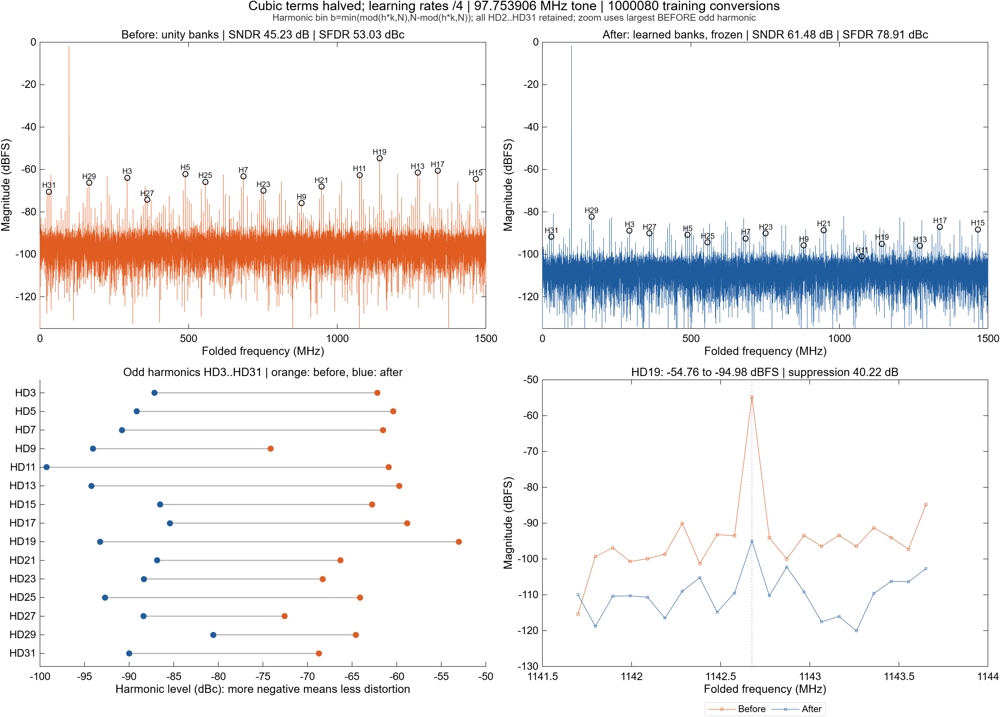
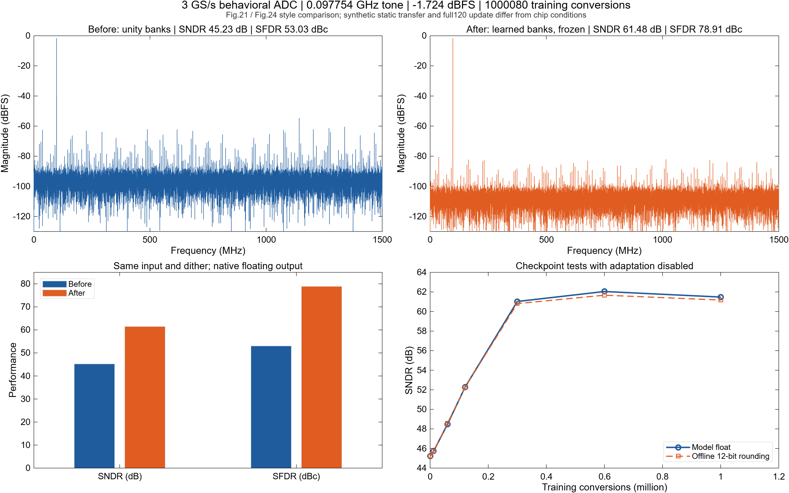
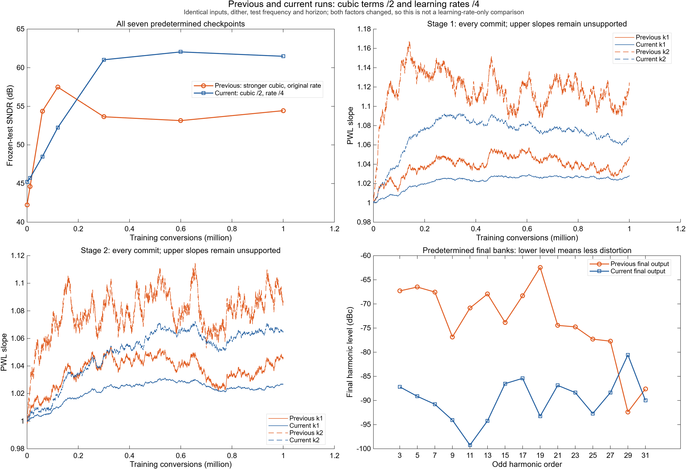
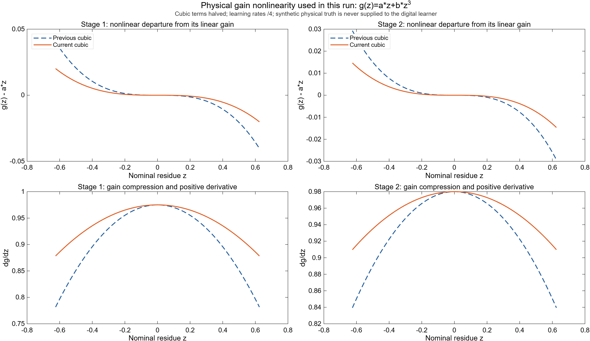
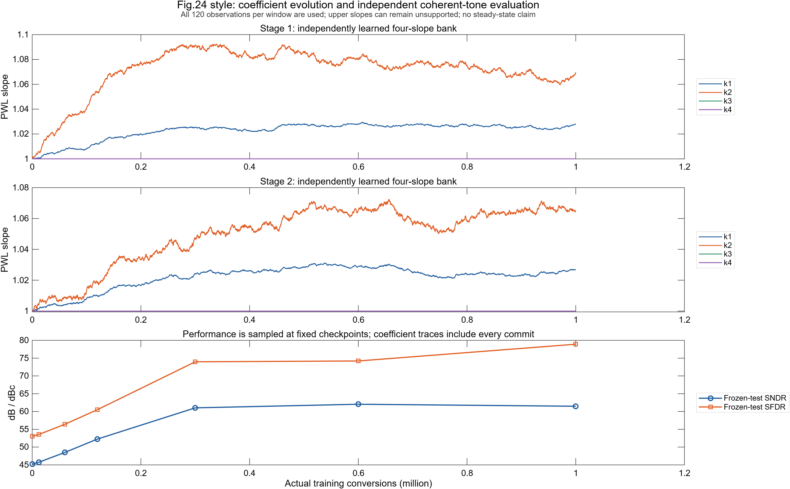
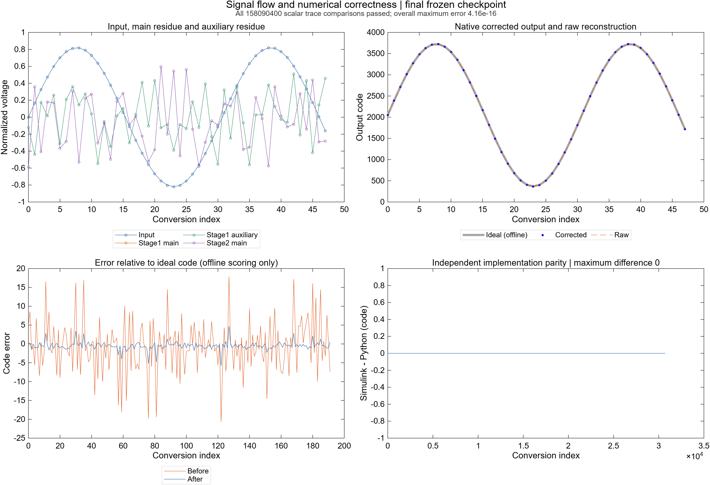

# ADC 校准前后性能演示与 Simulink 正确性核对

GitHub 仅发布最新参数的六组实验结果图；旧图和 `performance_runs/` 内的大体积原始数据留在本地。历史数值摘要及参数协议仍可查看，本地路径以行内代码标出。

最新追加结果：[减小非线性及学习率](#减小非线性及学习率后的结果)。三次项减半、两级学习率降至上一组的1/4；原基线和强非线性记录保留。

> 2026-10-10，基线运行 `20261010_performance_v1`；新增三倍非线性运行 `20261010_strong_harmonics_v1` 见 [增强非线性谐波结果](#增强增益非线性后的谐波对比)。本文交付用户要求的性能图与论文形式对标；区别于 [VALIDATION.md](VALIDATION.md) 的广泛短记录实现验收，不执行静态定点研究计划，也不重跑 EXP-057。

在固定参数、种子、步长和训练终点下，原 Simulink 模型实际完成 **1,000,080 次训练转换**。最终冻结两级学习系数后，浮点输出 SNDR 从 **46.4741 提升到 58.3381 dB**，SFDR 从 **53.9609 提升到 64.9478 dBc**。额外取整为 12 位整数码后，最终 SNDR／SFDR 为 **58.1102 dB／64.8728 dBc**。

全记录 **158,090,400 个标量信号**通过与原 Python 的核对：所有数字输出、学习信号和检查点系数数值相等；少量模拟电压存在最大 **4.4409×10⁻¹⁶** 的浮点差，低于预先规定的 10⁻¹² 电压容差。因此实现一致性通过，不能把所有模拟 trace 说成差值严格为零。

本次性能并非单调上升：120,000 次检查点的 SNDR 为 60.8045 dB，之后有回落，预定终点为 58.3381 dB。没有选择中途最高值替代终点，也没有延长训练或修改参数来追平论文。

## 参数与建模条件

运行前冻结合同见 [performance_protocol.json](performance_protocol.json)。原始运行中保存同字节协议、源码哈希及输入记录。

| 项目 | 本次设置与来源 |
|---|---|
| 架构 | 已验收的两级 Flash／CDAC 残差链与 8 位 SAR，最终名义 12 位；级间名义增益 4 |
| 第一级模拟传输 | `r1=0.975*z1−0.055*z1³`，`z1=4*(x−q1/4+tag1/32)` |
| 第二级模拟传输 | `r2=0.98*z2−0.04*z2³`，`z2=4*(r1−q2/4+tag2/32)` |
| 曲线来源 | 沿用 EXP-057 `both_smooth` 人工静态机制控制；不是芯片拟合曲线 |
| 主辅路径 | 静态匹配，辅路送第二级 Flash；主路送第二级 CDAC／残差求和 |
| 其他模拟项 | 理想 Flash／CDAC／SAR；没有阈值失配、电容失配、噪声、抖动、建立动态或 SAR 通道误差 |
| 训练输入 | 均匀分布 `[-0.82,0.82]`，NumPy PCG64 种子 `2026101011` |
| Dither | 两级独立 ±1 tag，模拟幅度 ±1/32；训练种子 `2026101012`，测试种子 `2026101013` |
| 初始系数 | 两级各四个系数，全部为 1 |
| 在线候选 | `C.digital_mode=4`，full120：每 120 次转换的全部观测累计，窗口末同时提交两级 bank |
| 步长 | 各级分子 `[1,3,6,12]`，第一级分母 `262144000`，第二级分母 `16384000`；沿用 EXP-057，没有调参 |
| 实际训练预算 | 每级 1,000,080 条学习观测，8,334 个窗口／提交 |
| 相干测试 | `N=30720`、`k=10241`、`fs=3 GHz`；`fin=1.00009765625 GHz`，输入峰值 0.82，即 −1.7237 dBFS |
| 测试策略 | 七个检查点均用同一正弦和 dither；冻结各自学习系数，测试中不更新 |
| 输出口径 | 主结果采用原模型浮点校正码；补充整数结果仅离线执行 `clip(floor(code+0.5),0,4095)` |

采样率只用于给离散转换记录赋予物理频率；模型每个 tick 为一次转换，不能把离散 tick 当作秒。`.slx` 内置的原 4096 点演示仍由原入口打开；上述配置通过性能运行器在仿真期间载入，运行器关闭模型时不保存这些临时配置。

## 两级校准怎样进入输出

每级分别有四段对称累积 PWL 和 gated-LMS bank，校正按后级到前级级联：

```text
c3 → PWL32(k2) → +128*q2 → −16*tag2 → PWL128(k1)
   → +512*q1 → −64*tag1 → +2048 → clip[0,4095]
```

当前转换使用旧系数，窗口末更新经 Unit Delay 在下一转换生效。第一级学习观测是其 PWL 输出扣掉本级 dither，第二级同理；学习器只读取数字 symbol、SAR 码、dither 与自身状态。理想目标 `2048*(x+1)` 只在仿真结束后计算码误差，不参与系数提取、停止或选型。

Python 使用原 `platform`／`calibration` 函数。Simulink 使用原生信号流程和嵌入函数，独立从单位 bank 学习；运行清单给所有任务的初始 bank 均写单位值，原生运行器自行接续其上一训练块的系数，测试也只用其自身当前 bank。没有将 Python 终点系数输入 Simulink。

为限制记录内存，静态训练按 12,000 次转换分块，末块 4,080 次；块长均为 120 及 4 的倍数，保留窗口边界和 SAR 通道相位。静态模拟没有需要接续的动态历史，完整窗口末累计量已清空；八个系数继续传递。局部观测／提交／门计数在每块复位，报告在离线累加这些实际计数。这个分块合同不适用于带动态历史的模型。

## 结果图与所有检查点

历史图保存在本地：`performance_figures/performance_overview.png`；GitHub 仅发布最新参数的实验结果图。

频谱采用完整 3 GS/s 码流、DC 至 1.5 GHz 积分带宽。左上／右上为单位 bank 与最终冻结 bank；右下显示全部预定检查点，同时区分浮点及离线取整结果。论文 60.3 dB 水平线只是参考，测试条件差异见后文。

| 训练转换数 | 浮点 SNDR / dB | 浮点 SFDR / dBc | 整数 SNDR / dB | 整数 SFDR / dBc |
|---:|---:|---:|---:|---:|
| 0 | 46.4741 | 53.9609 | 46.4741 | 53.9609 |
| 12,000 | 48.1779 | 55.6461 | 48.1170 | 55.5765 |
| 60,000 | 55.6186 | 64.3150 | 55.6517 | 64.4717 |
| 120,000 | 60.8045 | 74.4822 | 60.4949 | 74.7154 |
| 300,000 | 56.6631 | 63.1622 | 56.5056 | 63.1154 |
| 600,000 | 56.5777 | 63.5119 | 56.5084 | 63.5005 |
| **1,000,080** | **58.3381** | **64.9478** | **58.1102** | **64.8728** |

完整的 SNDR、SNR、THD、SFDR、ENOB、DC、谐波频点及最强杂散位置见 [performance_summary.json](performance_summary.json)。最终浮点 ENOB 为 9.3984 bit，整数为 9.3605 bit。相对理想码的浮点 MSE 从 32.4158 降至 2.4184 code²；该 MSE 包含直流误差，SNDR 的 FFT 则去除直流，二者不是同一指标。

历史图保存在本地：`performance_figures/coefficient_evolution.png`；GitHub 仅发布最新参数的实验结果图。

图中保留全部 8,334 次提交，没有平滑或挑选系数。最终第一级 bank 为 `[1.037118147,1.064291944,1,1]`，第二级为 `[1.031657738,1.056385439,1,1]`。固定步长下系数持续波动，七点测试不足以宣称整体稳态收敛。

这里只运行一组已见人工曲线、一个预定种子；收益属于这次条件记录，不代表跨种子、不同输入或物理器件的总体可靠性。

| 每级各段统计 | 第一段 | 第二段 | 第三段 | 第四段 |
|---|---:|---:|---:|---:|
| 第一级学习门打开数 | 1,000,080 | 452,371 | 0 | 0 |
| 第二级学习门打开数 | 1,000,080 | 470,991 | 0 | 0 |
| 第一级数字读出所在段数 | 533,633 | 371,318 | 95,129 | 0 |
| 第二级数字读出所在段数 | 520,983 | 378,757 | 100,340 | 0 |

第三段确实参与输出，却没有相应学习门；第四段没有读出和学习支持。`k3,k4` 保持 1 不能解读为已经正确收敛。这与既有静态候选的支持缺口相符，但本次不把全部性能差距归因于它，也不推广成论文电路的问题。

历史图保存在本地：`performance_figures/signals_and_parity.png`；GitHub 仅发布最新参数的实验结果图。

波形显示输入、主辅残差、第二级残差、原整数重构和校正输出；左下是离线理想码误差。当前主辅静态匹配，两条第一级残差曲线重合。右下显示最终测试全部 30,720 个数字输出的 Python／Simulink 差值为零。图为离散采样点连线，不表示模拟带宽或实际建立波形。

## 论文对标及本次没有复现的部分

公开接受作者稿 [Gu 等，A 12-b 3-GS/s Pipelined ADC With Piecewise-Linear Gain Nonlinearity Calibration](https://www.researchgate.net/publication/400043468_A_12-b_3-GSs_Pipelined_ADC_With_Piecewise-Linear_Gain_Nonlinearity_Calibration/fulltext/69746450ac604d40d0e5388d/A-12-b-3-GS-s-Pipelined-ADC-With-Piecewise-Linear-Gain-Nonlinearity-Calibration.pdf) 的 Fig. 21 在 1 GHz、0 dBFS 下报告 SNDR 54.0→60.3 dB、SFDR 62.7→76.0 dB；其基线已经做增益误差校准。本次使用仍含增益误差的单位 bank 基线和较低输入幅度，不能把两者的增益量直接当作算法优势比较。

| 对齐项 | 本次与论文的关系 |
|---|---|
| Fig. 21 形式 | 复现校准前后频谱与指标的展示形式；本次最终绝对指标未达到论文结果 |
| 输出位置 | 本次为完整 3 GS/s 码流；论文为并行四路处理后各抽取 30、选一路的测量读出，25 MS/s，频谱横轴不同 |
| Fig. 24 形式 | 显示系数演化与固定输入性能；论文展示第一级四系数和约 10⁷ 样本的收敛，本次为两级系数、1,000,080 次完整累计，不能比较芯片收敛速度 |
| 完整校准 | 本次只学习两级放大器 PWL，理想前端／后端无需前景校准；未迁移论文的电容权重提取／数字校正、Flash 修调及 SAR 通道校准 |
| 数值／调度 | 浮点 full120 候选；未实现论文 Q3 数据、系数字长或真实 4×750 MHz 硬件调度 |
| 物理误差 | 三次曲线是已有人工假设，缺少输入缓冲、采样失真、抖动及带宽，所以没有伪造 Fig. 22 的高频下降、PVT 或功耗图 |
| 静态线性 | 本次绘制码误差，没有执行满量程码密度协议，因此不将误差图标为论文 Fig. 20 的 DNL／INL |

本次读到作者稿正文和数值说明，未获得可渲染的原论文 PDF；不声称原始图版外观逐图核对。来源范围与已有论文核查一致。

## 验证与可复算记录

- 两端各自的 480 次连续／两段各 240 次运行预检通过，物理／数字输出及逐样本提交后 bank 分块等价。
- 正式训练 1,000,080 次，七组测试 215,040 次，预检 960 次；每个实现共实际执行 **1,216,080 次转换**。
- 94 个任务、每次 130 个记录字段：12,220 项字段检查、158,090,400 项标量比较全部通过；数字、学习及输入 trace 全相等，30 项任务／模拟字段出现容差内差值。
- 所有记录有限；训练及测试的模拟过载／数字输出裁剪计数为零。系数没有到达 `[0,2]` 边界，实际范围约 `[0.997244104,1.105393302]`。
- 原 `.slx` 和正式 Python 平台／校准源文件保持运行前指纹；38 项运行时源文件均在数值核对时匹配。首次视觉检查发现白底标题偏淡，之后只修订绘图字体颜色／大小及参考线样式；原绘图源和修订哈希另留档，不重新训练。
- MATLAB 独立 FFT 核对全部七检查点的浮点／整数 SNDR 和 SFDR：最大差分别为 **7.33×10⁻⁹ dB、2.27×10⁻¹³ dB**，通过 10⁻⁶ dB 的评分复核限。原指标模块 6 项测试通过；首次缺少 PyYAML 的启动错误在加入已有项目依赖路径后解决。
- 全部三图 PNG／SVG 导出并目视检查；绘图使用已通过核对的原生 Simulink 记录。

原始记录目录：performance_runs/20261010_performance_v1（本地：`performance_runs/20261010_performance_v1`）。包括同字节协议、原 Python 参考、原生 Simulink 小端 double 二进制 trace、17 位输入 CSV、列名／矩阵形状清单、独立状态、完整逐字段验收、指标、支持计数、MATLAB 日志及绘图 CSV。二进制每行按 `manifest.json` 的字段顺序写入，Python 可用 `read_binary` 读取，MATLAB 为 `fread(...,[columns,samples],'double=>double').'`。

复算命令（从项目根目录运行，始终创建新的时间戳目录）：

```powershell
.\simulink_adc\run_performance.ps1
# 如 MATLAB 不在 PATH：
.\simulink_adc\run_performance.ps1 -Matlab 'C:\Program Files\MATLAB\R2026a\bin\matlab.exe'
```

无需新增 DSP、Fixed-Point 或其他工具箱；Python 使用已有 NumPy／项目 PyYAML，图由 MATLAB 原生生成。协议中的性能是观察结果，不是强制达到 60 dB 的通过门；改变模拟条件、更新方式或预算，应另立新合同并重新核对。


## 增强增益非线性后的谐波对比

根据用户追加要求，已将两级放大器的**三次项增大为原来的 3 倍**，按新的冻结协议实际重跑 Python 和原生 Simulink。原来的线性增益、步长、种子、初始系数、full120 更新方式、训练预算和七个检查点保持同一合同，未根据结果调参或延长训练。原 1 GHz 演示及图文件独立保留。

| 项目 | 这次设置 |
|---|---|
| 第一级 | `g1(z)=0.975*z−0.165*z³`，原三次项为 `−0.055*z³` |
| 第二级 | `g2(z)=0.98*z−0.12*z³`，原三次项为 `−0.04*z³` |
| 残差输入 | `z_s=4*(main_s−q_s/4+tag_s/32)`；三次曲线作用在放大器输入残差上 |
| 主辅／其他误差 | 静态匹配主辅；理想 Flash／CDAC／SAR，无模拟噪声、抖动和建立动态 |
| 单调性 | `dg/dz=a+3*b*z²`；在声明范围 `[-1,1]` 的最小斜率分别为 0.480／0.620，均为正 |
| 训练 | 1,000,080 次真实转换、8,334 次窗口提交；均匀输入 `[-0.82,0.82]`，原预定种子与步长 |
| 相干测试 | `N=30720`、`k=1001`、`fs=3 GHz`、`fin=97.75390625 MHz`、峰值 0.82（−1.7237 dBFS） |
| 评分 | 七个检查点冻结独立学习的 bank；同一正弦和 dither；整段相干矩形 FFT，去 DC |
| 额外谐波统计 | HD2–HD31，分别保留浮点／离线整数码的 dBFS、dBc 和抑制量 |

曲线是新增的人工非线性压力条件，不是论文器件参数。此次降低测试频率是为把低阶谐波分开，**不能将这次和原 1 GHz 演示的绝对指标差异全部归因于三次项变强**；没有执行同频率的弱非线性 ADC 对照。有效的校准收益比较是本次同一输入、同一模拟条件下的前后比较。

### 谐波频谱、逐阶变化与局部放大

历史图保存在本地：`performance_figures/strong_nonlinearity_harmonics.png`；GitHub 仅发布最新参数的实验结果图。

上排分别显示单位 bank 与最终冻结 bank，标出 HD3–HD31 的奇次频点；左下比较相对基波的 dBc；右下放大**校准前最强的奇次谐波 HD19**，其 dBFS 从 −52.19 降至 −64.14，降低 11.95 dB。局部放大对象按校准前幅度选择，未按校准后抑制量挑选。

下面均为原生 Simulink **浮点输出的 dBFS**，抑制量定义为“校准前 − 校准后”，正值表示下降。dBc 以各自基波归一化，表格与图左下略有差别；基波前后分别为 −1.73024／−1.72034 dBFS。全体 HD2–HD31 的浮点及整数数据见 [harmonic_summary.json](harmonic_summary.json)、浮点谐波 CSV（本地：`performance_runs/20261010_strong_harmonics_v1/figures/harmonics.csv`） 和 整数谐波 CSV（本地：`performance_runs/20261010_strong_harmonics_v1/figures/harmonics_integer.csv`）。CSV 列顺序为阶数、FFT bin、折叠频率 Hz、前后 dBFS、前后 dBc、dBFS 抑制量、dBc 抑制量。

| 谐波 | 折叠频率 / MHz | 校准前 / dBFS | 校准后 / dBFS | 抑制量 / dB |
|---:|---:|---:|---:|---:|
| HD2 | 195.508 | -89.82 | -111.40 | 21.58 |
| HD3 | 293.262 | -61.72 | -69.02 | 7.30 |
| HD4 | 391.016 | -91.48 | -100.81 | 9.33 |
| HD5 | 488.770 | -59.80 | -68.22 | 8.42 |
| HD7 | 684.277 | -60.93 | -69.26 | 8.33 |
| HD9 | 879.785 | -72.98 | -78.55 | 5.57 |
| HD11 | 1075.293 | -60.47 | -72.58 | 12.11 |
| HD13 | 1270.801 | -59.39 | -69.66 | 10.26 |
| HD15 | 1466.309 | -61.67 | -75.54 | 13.87 |
| HD17 | 1338.184 | -58.17 | -70.03 | 11.86 |
| HD19 | 1142.676 | -52.19 | -64.14 | 11.95 |
| HD21 | 947.168 | -66.68 | -76.16 | 9.48 |
| HD23 | 751.660 | -67.25 | -76.47 | 9.22 |
| HD25 | 556.152 | -63.07 | -79.02 | 15.95 |
| HD27 | 360.645 | -72.42 | -79.43 | 7.01 |
| HD29 | 165.137 | -62.54 | -94.10 | 31.56 |
| HD30 | 67.383 | -108.13 | -94.50 | -13.64 |
| HD31 | 30.371 | -66.48 | -89.31 | 22.83 |

本次 15 个奇次谐波 HD3–HD31 均下降；**偶次谐波并未全部改善**，HD30 从 −108.13 变为 −94.50 dBFS，增大 13.64 dB。该低电平频点的量化、有限 dither 及残留误差贡献未作单独因果分解，因此保留结果，不宣称所有谐波均已消除。

高于 Nyquist 的谐波按 `b=min((h*k) mod N, N−((h*k) mod N))` 折叠到单边谱。本例 HD19 的原频率为 1,857.324 MHz，在图中位于 **1,142.676 MHz**。HD2–HD31 的折叠 bin 均互不相同，且不与 DC／基波重合。

三次放大器不意味着整机只出现三次谐波：Flash／CDAC 先把正弦变成分段残差，三次函数作用在该残差上；两级级联、后端量化及数字 PWL 共同决定码域误差的傅里叶分量。因此整机可有 HD5、HD7、HD19 等较高次谐波，不能将整机直接等效为 `a*sin(t)+b*sin(t)^3`。

额外的 **THD2–31 从 −46.6228 降至 −57.6420 dB**，改善 11.0191 dB。这是指定 30 个谐波的功率和，相对各自基波归一化；原指标模块的 `THD2–5` 和 `SNR` 定义保持原样，不能混用。SNDR 始终计入全带宽所有非 DC／非基波功率，而非只统计这些指定谐波。

### 曲线、性能和学习支持

历史图保存在本地：`performance_figures/strong_nonlinearity_transfer.png`；GitHub 仅发布最新参数的实验结果图。

该图比较旧／新配置的非线性偏离 `g(z)−a*z` 和微分增益，用于解释参数；不是通过校准数据反向拟合的传输。已知模拟真值只用于平台及这张离线说明图，没有输入在线学习器。

历史图保存在本地：`performance_figures/strong_performance_overview.png`；GitHub 仅发布最新参数的实验结果图。

| 训练转换数 | 浮点 SNDR / dB | 浮点 SFDR / dBc | 整数 SNDR / dB | 整数 SFDR / dBc |
|---:|---:|---:|---:|---:|
| 0 | 42.2326 | 50.4629 | 42.2326 | 50.4629 |
| 12,000 | 44.6357 | 53.0321 | 44.6013 | 52.9893 |
| 60,000 | 54.3789 | 66.8113 | 54.3045 | 66.4442 |
| 120,000 | 57.4867 | 75.3626 | 57.3783 | 75.5514 |
| 300,000 | 53.6453 | 60.9867 | 53.5730 | 60.9562 |
| 600,000 | 53.1488 | 60.9047 | 53.1105 | 60.8534 |
| 1,000,080 | 54.4349 | 62.4220 | 54.3752 | 62.4387 |

预定终点浮点 **SNDR 42.2326→54.4349 dB，SFDR 50.4629→62.4220 dBc**；离线取整终点为 54.3752 dB／62.4387 dBc。120,000 次时曾到 57.4867 dB，之后回落，未用这个中途最高值替代终点。校准收益与固定步长波动同时存在，不能宣称整体单调或稳态收敛。

历史图保存在本地：`performance_figures/strong_coefficient_evolution.png`；GitHub 仅发布最新参数的实验结果图。

最终第一级 bank 为 `[1.047030977,1.122532363,1,1]`，第二级为 `[1.045476089,1.087161047,1,1]`。全部提交均保留；系数范围约 `[0.998205758,1.167266719]`，没有到达 `[0,2]` 边界。

| 各段实际支持 | 第一段 | 第二段 | 第三段 | 第四段 |
|---|---:|---:|---:|---:|
| 第一级学习门打开数 | 1,000,080 | 451,711 | 0 | 0 |
| 第二级学习门打开数 | 1,000,080 | 450,739 | 0 | 0 |
| 第一级数字读出段数 | 537,640 | 384,251 | 78,189 | 0 |
| 第二级数字读出段数 | 530,605 | 381,622 | 87,853 | 0 |

第三段仍参与读出而没有更新门，第四段无支持，保持单位值不代表已正确学习。这里只有一个固定种子；本次结果说明指定压力条件下的校准收益，不能作为跨输入、跨种子或芯片准确性结论。

历史图保存在本地：`performance_figures/strong_signals_and_parity.png`；GitHub 仅发布最新参数的实验结果图。

### 复核与保存

- Python 和 Simulink 分别通过 480 次连续／两段各 240 次的分块预检，均从单位 bank 开始；两者独立学习并接续自己的系数，Simulink 不读 Python 学习结果。
- 每端实际完成 1,216,080 次转换，包括训练 1,000,080、七组冻结测试 215,040、预检 960。
- **158,090,400 个标量、12,220 项字段检查全部通过**；数字／学习／输入记录数值全相等，模拟电压最大差 4.44×10⁻¹⁶，检查点系数差为零。训练／测试均无模拟过载或输出裁剪。
- 数值核对时全部 42 个运行时源文件与冻结指纹一致；原 Python 平台／校准及 `.slx` 保持原样。之后独立 FFT 复核脚本修正新增谐波检查中的局部变量名 `s`→`summary`，未改变 ADC、学习器或 Python 主评分。原版本保存在 `source_snapshot/`，前后哈希和原因见 QA 修订记录（本地：`performance_runs/20261010_strong_harmonics_v1/post_scoring_qa_revision.json`）。
- MATLAB 独立 FFT 复核七检查点的浮点／整数 SNDR、SFDR，以及前后两种输出的全部 30 个谐波 dBFS／dBc 和 THD2–31；最大 SNDR／SFDR 差为 1.10×10⁻⁸／2.84×10⁻¹⁴ dB，谐波电平／THD 差为 **5.24×10⁻¹²／2.13×10⁻¹⁴ dB**，均通过 10⁻⁶ dB 限。
- 五组 PNG／SVG 已导出并目视检查；10 个预览文件与原图 SHA-256 相等，SVG XML 可解析。42 份冻结源码快照、849 份原始参考／原生记录及其哈希保留；原基线摘要保持原字节。

完整数据位于 performance_runs/20261010_strong_harmonics_v1（本地：`performance_runs/20261010_strong_harmonics_v1`），入口摘要为 [harmonic_summary.json](harmonic_summary.json)，数值验收、独立 FFT 复核、归档检查分别见 verification.json（本地：`performance_runs/20261010_strong_harmonics_v1/verification.json`）、metrics_verification.json（本地：`performance_runs/20261010_strong_harmonics_v1/metrics_verification.json`）、delivery_checks.json（本地：`performance_runs/20261010_strong_harmonics_v1/delivery_checks.json`）。上述内容延续原浮点可视化交付，不启动 T1–T5 定点计划或新算法。

从项目根目录复算，运行器会创建新的时间戳目录：

```powershell
.\simulink_adc\run_performance.ps1 -Protocol .\simulink_adc\performance_harmonics_protocol.json
```


## 减小非线性及学习率后的结果

按用户新要求，在上一组强非线性设置上**将两级三次项减半、学习率降为1/4**，完成独立冻结协议和原生仿真。协议见 [performance_reduced_protocol.json](performance_reduced_protocol.json)，运行 `20261010_reduced_nonlinearity_rate_v1`。这是当前用户要求的浮点行为演示，不执行已批准的 T1—T5 定点研究。

| 参数 | 上一组强非线性 | 这次 |
|---|---|---|
| 第一级实际传输 | `0.975*z−0.165*z³` | `0.975*z−0.0825*z³` |
| 第二级实际传输 | `0.98*z−0.12*z³` | `0.98*z−0.06*z³` |
| 第一级学习率 | `[1,3,6,12]/262144000` | `[1,3,6,12]/1048576000` |
| 第二级学习率 | `[1,3,6,12]/16384000` | `[1,3,6,12]/65536000` |

分母增大4倍表示每段步长降至1/4；full120 的累计及窗口末提交合同保持原样。线性增益、主辅匹配、理想 Flash／CDAC／SAR、无模拟噪声或动态的假设也保持原样。新曲线在声明范围 `[-1,1]` 的最小微分增益为0.7275／0.8000，仍严格为正。这些曲线是人工条件，不是器件拟合值。

两端均从单位 bank 开始独立学习，固定 **1,000,080 次训练转换、8,334 次提交和原七个检查点**；同一组 PCG64 种子、训练输入、测试正弦和 dither。测试仍为 `N=30720`、`k=1001`、`fs=3 GHz`、`fin=97.75390625 MHz`、峰值0.82，检查点测试冻结 bank。

预期较小三次项减轻未校准失真，较小学习率可能减轻系数起伏但延缓学习；这些是条件性预期，不是性能验收门。**两个因素同时改变，不能把两组之间的改善单独归因于学习率或非线性**；本轮未加单因素对照、未扫描步长、未根据结果延长训练。

### 校准前后谐波



图中橙色为单位 bank，蓝色为预定终点 bank；左下为 dBc，右下放大校准前最强的奇次谐波 HD19。HD19 原频率1857.324 MHz折叠到1142.676 MHz，前后使用同一个 bin；选图按校准前幅度，未按抑制量选择。

以下为原生 Simulink **浮点输出 dBFS**，抑制量为“前−后”。完整 HD2–HD31 的浮点／整数 dBFS、dBc及抑制量见 [reduced_summary.json](reduced_summary.json)、浮点 CSV（本地：`performance_runs/20261010_reduced_nonlinearity_rate_v1/figures/harmonics.csv`）、整数 CSV（本地：`performance_runs/20261010_reduced_nonlinearity_rate_v1/figures/harmonics_integer.csv`）。列定义沿用上节，折叠 bin 均不同且不与 DC／基波相撞。

| 谐波 | 校准前 / dBFS | 校准后 / dBFS | 抑制量 / dB |
|---:|---:|---:|---:|
| HD2 | -91.94 | -106.39 | 14.45 |
| HD3 | -63.88 | -88.90 | 25.01 |
| HD4 | -94.64 | -106.12 | 11.49 |
| HD5 | -62.12 | -90.86 | 28.75 |
| HD7 | -63.24 | -92.51 | 29.26 |
| HD9 | -75.87 | -95.79 | 19.91 |
| HD11 | -62.62 | -100.96 | 38.35 |
| HD13 | -61.43 | -95.95 | 34.52 |
| HD15 | -64.47 | -88.24 | 23.77 |
| HD17 | -60.55 | -87.14 | 26.59 |
| HD19 | -54.76 | -94.98 | 40.22 |
| HD21 | -68.03 | -88.60 | 20.57 |
| HD23 | -70.02 | -90.08 | 20.06 |
| HD25 | -65.84 | -94.42 | 28.58 |
| HD27 | -74.32 | -90.11 | 15.79 |
| HD29 | -66.31 | -82.29 | 15.98 |
| HD30 | -103.14 | -104.47 | 1.34 |
| HD31 | -70.45 | -91.72 | 21.27 |

本次选定的30个谐波均低于本次校准前电平，其中 HD3／HD5／HD7／HD19 分别降低25.01／28.75／29.26／40.22 dB。额外 **THD2–31 为 -49.1046→-75.8171 dB**，改善 26.7125 dB；该口径与原 `THD2–5` 分开。谐波仍有残留，全带宽非基波功率仍计入 SNDR。

### 所有检查点与新旧对比



| 训练转换数 | 浮点 SNDR / dB | 浮点 SFDR / dBc | 整数 SNDR / dB | 整数 SFDR / dBc |
|---:|---:|---:|---:|---:|
| 0 | 45.2334 | 53.0304 | 45.2334 | 53.0304 |
| 12,000 | 45.7297 | 53.5308 | 45.7135 | 53.4983 |
| 60,000 | 48.4987 | 56.4093 | 48.5957 | 56.4805 |
| 120,000 | 52.2546 | 60.5152 | 52.2467 | 60.4352 |
| 300,000 | 61.0253 | 73.9649 | 60.8051 | 73.9335 |
| 600,000 | 62.0431 | 74.1996 | 61.6673 | 73.8591 |
| 1,000,080 | 61.4768 | 78.9052 | 61.1724 | 79.0189 |

预定终点浮点 **SNDR 45.2334→61.4768 dB，SFDR 53.0304→78.9052 dBc**；额外12位离线取整终点为 61.1724 dB／79.0189 dBc。前期提升较缓，30万次后明显提高；60万次为62.0431 dB，终点回落至61.4768 dB，未用最高点代替终点，不宣称单调或整体稳态。



橙色为上一组，蓝色为这次；图显示全部七检查点、每次提交的低两段系数，以及全部15个奇次终点谐波。新组的系数轨迹较平滑，但两组需要的校正斜率也因模拟曲线不同而不同；不能把 bank 数值较小直接解释为学习方差较小。

| 同频率／同预算终点浮点指标 | 上一组 | 这次 |
|---|---:|---:|
| SNDR / dB | 54.4349 | 61.4768 |
| SFDR / dBc | 62.4220 | 78.9052 |
| HD3 校准后 / dBFS | -69.02 | -88.90 |
| HD5 校准后 / dBFS | -68.22 | -90.86 |
| HD7 校准后 / dBFS | -69.26 | -92.51 |
| HD19 校准后 / dBFS | -64.14 | -94.98 |
| HD29 校准后 / dBFS | -94.10 | -82.29 |

**相对这次自己的校准前，HD2–HD31均下降；相对上一组的校准后，HD29反而更高**（−94.10→−82.29 dBFS）。因此不能把总体指标提升说成每个谱线都优于上一组。跨组差异仍是非线性与学习率联合修改的结果，本组只含一个固定种子，不能外推总体可靠性。



这张离线说明图仅展示配置的模拟真值；真值及理想目标码未输入在线学习器。



最终第一级 bank 为 `[1.028162161, 1.068929486, 1, 1]`，第二级为 `[1.026767932, 1.065194826, 1, 1]`。全过程系数范围约 `[0.999471457,1.092615689]`，无系数边界裁剪。

| 各段支持 | 第一段 | 第二段 | 第三段 | 第四段 |
|---|---:|---:|---:|---:|
| 第一级门打开数 | 1,000,080 | 453,219 | 0 | 0 |
| 第二级门打开数 | 1,000,080 | 465,318 | 0 | 0 |
| 第一级数字读出段数 | 534,617 | 374,275 | 91,188 | 0 |
| 第二级数字读出段数 | 523,835 | 378,887 | 97,358 | 0 |

第三段参与输出但无学习门，第四段无支持，`k3,k4=1` 不表示正确学习；较小学习率没有补足这个缺口。本次仍保留该限制，不将全部残余失真归因于高段。



### 实现核对及可复算记录

- 性能驱动现在从所选协议读取步长，仅改内存中的配置副本；EXP-057原协议、正式 Python 平台／校准与原 `.slx` 均未修改。旧参数480次参考重算全记录相等；新参数导出的两级步长精确为旧值1/4，94个任务的实际参数、初始单位 bank 与三次系数再次核对通过。
- Python／Simulink分别通过480次连续与两段240次的分块预检，并独立接续自身系数。每端共1,216,080次实际转换；七组测试期间 bank 冻结。
- **158,090,400 个标量、12,220项字段核对全部通过**；数字／学习／输入数值全相等，模拟最大差 **4.163e-16**，检查点系数差为0。所有记录有限，训练／测试均无模拟过载和输出裁剪。
- MATLAB独立FFT复核七检查点浮点／整数SNDR和SFDR，以及前后HD2–HD31电平及THD。最大SNDR／SFDR误差为 3.54e-08／2.13e-13 dB，谐波电平／THD误差为 3.25e-12／1.56e-13 dB，均通过10⁻⁶ dB限。
- 42个运行时源文件在核对和交付时均匹配冻结指纹；另保留新增离线新旧绘图源及哈希。849份原始参考／原生文件、完整状态、参数、日志和评分已归档。六组PNG／SVG已目视检查、XML解析并核对复制哈希；旧两组摘要及16个旧预览保持原字节。

入口摘要为 [reduced_summary.json](reduced_summary.json)，完整记录位于 performance_runs/20261010_reduced_nonlinearity_rate_v1（本地：`performance_runs/20261010_reduced_nonlinearity_rate_v1`）；数值核对（本地：`performance_runs/20261010_reduced_nonlinearity_rate_v1/verification.json`）、独立FFT复核（本地：`performance_runs/20261010_reduced_nonlinearity_rate_v1/metrics_verification.json`）、交付检查（本地：`performance_runs/20261010_reduced_nonlinearity_rate_v1/delivery_checks.json`）。冻结旧记录不覆盖，本次未提交／推送。

从项目根目录复算会创建新的时间戳目录：

```powershell
.\simulink_adc\run_performance.ps1 -Protocol .\simulink_adc\performance_reduced_protocol.json
```

该命令生成本组五张标准图；与上一组叠加的第六张图用 `render_adc_run_comparison(new_run,previous_run)` 读取两个已经核对通过的运行目录绘制，不参与模拟、学习或评分。
