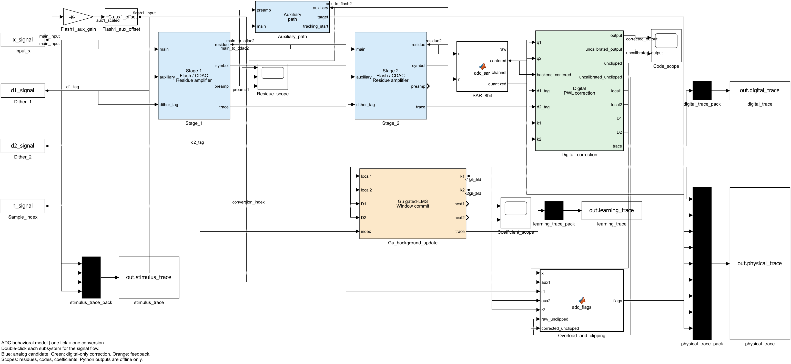

# Simulink 与原 Python 一致性验收

2026-10-10 完成。最终可编辑模型为 [adc_behavioral.slx](adc_behavioral.slx)，复算入口为 [run_validation.ps1](run_validation.ps1)。这是用户要求的实现迁移与信号可视化，不新增编号研究实验或理论结论。

## 结果

23 组、82,343 次转换、130 个标量字段／转换，共 2,990 项按条件分组的字段检查全部通过。最终四组 trace 的最大绝对误差均为 **0**：输入与 dither、模拟与判决、数字输出、学习与状态。校正浮点输出及未校正整数输出、两级系数前后状态、门限、门、相关乘积、计数和提交均与原 Python 逐样本数值相等。

| 控制 | 条件／转换数 | 所核对的问题 |
|---|---:|---|
| ideal_grid | 12,288 | 全部理想 12 位码边界及上下相邻双精度数，含输入端点 |
| ideal_dither | 49,152 | 同一边界网格的四种 dither 组合与局部数字扣除 |
| 11 组静态／冻结控制 | 各 480 | 阈值偏移、DAC 失配、增益、模拟 PWL、组合项、辅路失配、EXP-057 四种误差曲线、冻结非单位系数 |
| 4 组动态控制 | 各 480 | 单相主路、独立主辅单相、独立两相、零建立因子退化 |
| 4 组在线控制 | 各 2,400 | 逐转换、point30、full120，以及所有转换推进历史的动态 full120 |
| overload_bypass | 7 | 输入／残差越界、裁剪和可纠正标记，不向超域 PWL 强行输入 |
| demo_tone | 4,096 | 相干 bin127 单音，在线系数、波形与频谱 |

独立原语检查还有 48 个 PWL 探针、30 个门限等值／邻点探针、773 个 SAR 探针，及 4 个非法 PWL 输入拒绝。误差均为 0。再次启动同一演示仿真，四组 trace 完全相等，确认窗口累计、模拟历史和系数 bank 均复位。

模型结构审查检查了 16 个 MATLAB Function 的嵌入代码与 `blocks/` 文件一致、4 个刺激入口只读模型工作区中的输入／dither／转换序号、5 个反馈 Unit Delay 显式保存状态。包含内部块的模型共有 293 个块；MATLAB/Simulink R2026a Update 2，FixedStepDiscrete，步长 1。该块数包括 MATLAB Function 自动生成的内部结构，不是硬件成本。

相关原 Python 回归运行了 73 项并通过，覆盖行为配置、Gate A—D、三次传输、三种动态、PWL 端点、LMS／两级自适应和信息边界。未修改 `src/`、原配置、冻结实验及 RTL。

## 演示指标

使用项目已有 `metrics/spectral.py` 对两端各自输出离线评分，4096 点、bin127、3 GHz、幅度 0.82、矩形窗。这里只评价这段演示，不当作长期稳态或芯片指标。

| 输出 | Python SNDR | Simulink SNDR | Python SFDR | Simulink SFDR |
|---|---:|---:|---:|---:|
| 未校正整数输出 | 46.530693871244 dB | 46.530693871244 dB | 54.089695739914 dBc | 54.089695739914 dBc |
| 在线校正浮点输出 | 48.415000081603 dB | 48.415000081603 dB | 56.530370145832 dBc | 56.530370145832 dBc |

## 证据与复现

验收条件在运行前写入 [validation_protocol.json](validation_protocol.json)。摘要、环境、源文件及最终 `.slx` 的 SHA-256 保存在 [validation_summary.json](validation_summary.json)。当前原始记录位于本地 `validation_runs/20261010_160922/`，包括 `reference/manifest.json`、全部两端 CSV、`parity.json`、`simulink/execution.json` 和日志；该目录按本项目惯例不入 Git。摘要可追溯已有验收，但不能代替缺失的本地原始数据；可按一键入口重新生成新的运行。

第一次开发预检发现 MATLAB 矩阵信号为 `[行,列,时间]`，原导出检查预期 `[时间,字段]`，因此导出中止；现已显式转换维度。随后旧数字求和关联顺序产生最多 `4.547473508864641e-13` 码差，虽通过原容差，仍把原生 Sum 改成与 Python 相同的 `(512*q1+PWL1)-D1` 顺序。最终全部记录的数值差为零，参数、输入、步长、预算和容差未调整；此前运行保留。



历史图保存在本地：`python_simulink_comparison.png`；GitHub 仅发布最新参数的实验结果图。

实际模型的逐级、数字校正、学习内部视图另见 `stage_detail.png`、`digital_detail.png`、`learning_detail.png`，可在 `.slx` 中双击对应子系统直接查看。

## 结论的范围

“相等”指本次冻结测试中双精度数值逐样本相等，未比较 IEEE 位模式中的正负零，也不保证任意新条件、其他 MATLAB 版本或未来源码仍自动一致；新配置应重新核对。验收仍保留预定浮点容差，当前实际误差小于该合同且为零。

模拟传输、主辅关系、建立过程和窗口更新是原有行为候选，尚非芯片测得事实。本次不包括 Q3／Q1.10／Q22 定点、RTL、连续后端 oracle、噪声／时钟失配、新算法或百万量级研究；已批准的静态定点研究接续任务保持未执行状态。

## 与原论文的主辅路径及两级校准核对

2026-10-10 根据用户追加问题，核对 Gu OJSSCS 2026 的公开接受作者稿、正式 Python 及保存的 `.slx`。来源为 [14 页作者稿 PDF](https://www.researchgate.net/publication/400043468_A_12-b_3-GSs_Pipelined_ADC_With_Piecewise-Linear_Gain_Nonlinearity_Calibration/fulltext/69746450ac604d40d0e5388d/A-12-b-3-GS-s-Pipelined-ADC-With-Piecewise-Linear-Gain-Nonlinearity-Calibration.pdf)，DOI `10.1109/OJSSCS.2026.3656850`。读取了 PDF 可提取正文及图中文字；当前本地论文缺失，网页逐页渲染与直接下载未成功，因此没有声称完成原图视觉复核或检查出版商最终编辑版。来源登记在 [文献清单](../references/source_manifest.yaml)。以下页码按这个作者稿的 PDF 页码计。

### 主辅路径的含义与实现

Sec. III-A、p. 7、Fig. 13 与 Table 1：第一级残差经过并行的主、辅放大器，主路驱动第二级 CDAC，辅路驱动第二级 Flash。主路承担高精度信息传递；辅路负责粗判决，精度／带宽要求可放宽。两路分开还能隔离 Flash kickback，使 Flash 判决和 CDAC 建立并行。表中主／辅建立要求为 10／5 bit，100／80 ps，带宽 11／7 GHz。主辅是第一级内的并行放大，两级残差放大则是沿主信息链的前后级放大，两个概念应分开。

令 `u1=x-DAC1(q1)+d1`，一般独立路径可写为 `r1_main=g1(4*u1)`、`r1_aux=h1(4*u1)`；两函数可以有不同非线性和历史。第二级在 `r1_aux` 判决 `q2`，但在主路上形成 `u2=r1_main-DAC2(q2)+d2`，然后产生 `r2_main=g2(4*u2)` 并送给 SAR。这里的函数和归一化坐标是行为表达，不是论文已公开的硅传输参数。

实际保存模型的 `Stage_1/residue` 接 `Stage_2/main`，`Auxiliary_path/auxiliary` 接 `Stage_2/auxiliary`；后者只进入该级 Flash，主路进入 CDAC 残差求和。这与 Python `platform/pipeline.py` 一致。默认辅路为 `rho*r1_main+offset`；独立主辅单相／两相模式另有辅路传输及历史。默认近似不能验证两条物理放大器、kickback 隔离和皮秒时序。根层 `Flash1_aux_gain/offset` 是第一级 Flash 输入坐标的可选误差接口，默认 1／0，不能当成论文所述的第一级残差辅助放大器。

### 原论文如何校准两级放大

Sec. III-C、p. 9、Fig. 18：同一个片上数字引擎内，每个并行处理单元先校正 SAR 和第二级放大器／CDAC，重构第一级输出的数字码，再校正第一级放大器／CDAC。因此是 **两级分别校正、数字结果从后级向前级级联重构**。数字引擎位于模拟流水线之后符合论文架构；物理放大器输出不因数字校正而自动变成理想电压。校正的运算次序也不等于学习必须先收敛第二级、再启动第一级。

在当前候选码制中，令 `F1`、`F2` 分别为第一、第二级数字 PWL，`c3` 为 SAR centered code：

```text
p2 = F2(c3; k2)
raw1 = (128*q2 + p2) - D2
p1 = F1(raw1; k1)
output = clip(((512*q1 + p1) - D1) + 2048, 0, 4095)
Y2 = p2 - D2
Y1 = p1 - D1
```

`Y1`／`Y2` 是各级局部学习输出，分别排除本级粗码 `512*q1`／`128*q2`。它们进入各自的 dither 相关量与门控，最终 12-bit 输出没有直接作为两组 bank 的共同学习误差。局部 dither 应在本级 PWL 之后扣除；启用非线性校正时，不能把 `D1+D2` 一律留到整个级联之后再扣。原权重／码表、第二级分段宽度和端点延伸仍按项目候选的证据边界解释。

| 核查项 | Python | 保存的 Simulink 内部 | 判断 |
|---|---|---|---|
| 分别校正两级 | `two_stage.py` 先调用第二级、再第一级 `correct` | `PWL_stage_2` → `Raw_stage_1` → `PWL_stage_1` | 与论文校正级联一致 |
| 独立状态 | `TwoStageAdaptiveState.stage1/stage2` | 两个 `Coefficient_bank` Unit Delay，各四个系数 | 两套状态，共八个系数 |
| PWL 连续性 | `pwl.py` 累计前段斜率形成 offset | `adc_pwl.m` 同样累计，宽度 128／32 | 符合 Eq. (2)-(3) 的原理 |
| 各级学习观测 | `adaptive_two_stage.observe` 生成各级 PWL 输出减本级 dither | `Local_learning_1/2` → `Gates_1/2` | 各级局部相关量，无模拟真值输入 |
| 门控与更新方向 | 第一斜率全用，高段按自适应累计下阈值，`-mu*D*Y` | `adc_gate.m`、`adc_update.m` 同式 | 符合 Eq. (5)-(7)、Fig. 10 的原理；具体步长为项目配置 |
| 系数生效 | 当前样本用旧状态，形成两组下一状态 | 两组更新经过 Unit Delay 后生效 | 两端一致；论文不提供完整广播／提交真值表 |

### 与完整论文引擎仍不同的地方

1. **辅路失配修调。**论文 p. 7 指出主辅增益／失调差通过第二级比较器的前景 offset trimming 处理；它不是第三套辅助放大器数字 PWL。当前 Python／Simulink 能配置辅路失配和 Flash 阈值偏移，但没有执行前景测量、提取、修调闭环。默认主辅匹配不能当作已经模拟了论文修调。
2. **电容失配校准。**论文 p. 9 提取、归一化并写入电容权重。当前两端只在模拟 CDAC 中注入失配，数字 `Coarse_1/2` 仍为固定 512／128，并没有对应的逐状态校准权重表和前景提取。因此“支持模拟失配”与“实现电容失配校准”不同。
3. **SAR 通道校准。**论文 p. 7、9 包含 SAR 电容及通道 offset／gain 处理。当前后端是理想 8-bit 量化及 `n mod 4` 通道标签，没有这些通道非理想和校准回路。
4. **定点与并行硬件。**论文 p. 3 给出 11-bit／10 个小数位系数示例，p. 9 指出四路 750 MHz 处理及全过程三个小数位。当前 `.slx` 是逐转换双精度参考，没有迁移既有 Q3／Q1.10／Q22 或四路时钟调度。
5. **抽取／提交。**论文 p. 9-10 报告学习前抽取 30 及测量输出抽取 120；没有公开完整选样相位、跨路合并、提交、广播和全部步长。默认 point30 每 120 次转换选前四点、窗口末提交、乘 30，是项目明确候选；full120 是机制控制，两者都不能称论文已确认的逐拍实现。
6. **模拟曲线与物理时序。**默认 `both_smooth` 三次曲线和动态候选均为人工控制，真实独立主辅曲线与动态参数尚未识别。

结论：两端没有“只用一套 PWL 校正最终码”的结构错误；两级 PWL、独立 bank、局部 dither、门控原理与论文一致。完整电容／SAR／前景修调、定点及硬件时序尚未复原。本次维持原模型数值行为，仅加强 [结构审查](audit_adc_model.m) 与说明，没有以补齐论文为名改动原研究合同。

### 本次核对证据

实际加载 `.slx` 的审查通过：42 条主辅／数字／反馈关键连接，两个 PWL、两个四系数 bank、局部学习端口和 Sum 正负号；16 个嵌入 MATLAB Function 与文件一致。模型工作区确认默认辅路模式 0、数字模式 3。另运行 24 项原 Python 两级自适应、gated-LMS、两级 PWL 和主辅回归，全部通过。53 项原 Python／配置／Simulink 计算文件及模型指纹与此前一致性验收相同；只有本次扩展的审查脚本不纳入“未变”声明。机器摘要见 [paper_audit_summary.json](paper_audit_summary.json)，本地 MATLAB 审查结果为 `outputs/paper_model_audit.json`。这些是实现／结构核查，不是新研究实验或新的收敛结论。
